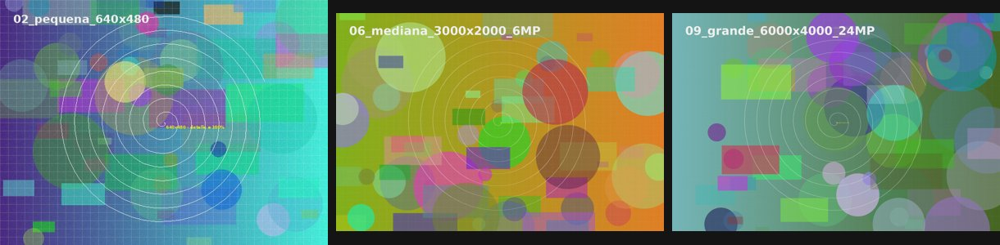

# PicaRust

**El visor de imágenes más rápido posible, al estilo del visor de Picasa.**
*A tiny, instant image viewer written in Rust, inspired by the Picasa Photo Viewer.*

Haces doble clic en una foto y aparece al instante, a pantalla completa. Zoom con la rueda, `Esc` y se cierra. Nada más: sin biblioteca, sin catálogo, sin ventanas de opciones. Una sola función: **ver imágenes, rápido**.



<!--
Añade aquí tus capturas de la app (no se pueden generar automáticamente):


-->

## Características

- **Arranque inmediato**: decodifica en hilos de fondo y precarga la foto anterior y la siguiente, así que pasar de una a otra es instantáneo.
- **Pantalla completa** con fondo semitransparente (tecla `T` cambia la opacidad).
- **Zoom rápido en la tarjeta gráfica**: rueda del ratón hacia el cursor, pellizco, `↑`/`↓` continuo, `+`/`-`, `0` ajustar, `1` al 100 %.
- **Modo píxeles** (`P`): al ampliar se ven los píxeles reales, sin interpolar. Por defecto se suaviza al ampliar y se filtra con mipmaps al reducir.
- **Panel de información** (`I`): formato, dimensiones, megapíxeles, tamaño, tiempo de decodificación y metadatos **EXIF** (cámara, objetivo, fecha, exposición, apertura, ISO, focal, flash, GPS…).
- Respeta la **orientación EXIF** (las fotos verticales se ven derechas).
- Navegación por la carpeta, giro de la vista (`R`/`L`), presentación (`S`) y arrastrar y soltar.
- Formatos: JPEG, PNG, GIF, WebP, BMP y TIFF.
- Binario único de ~8 MB, sin dependencias en tiempo de ejecución más allá de las librerías gráficas del sistema.

## Controles

| Tecla / acción | Efecto |
|---|---|
| `Esc`, clic fuera de la foto | Cerrar |
| Rueda, `↑` `↓`, `+` `-` | Zoom |
| Arrastrar | Mover la imagen |
| Doble clic | Alternar ajustar / 100 % |
| `0` / `1` | Ajustar a pantalla / 100 % |
| `←` `→`, `Espacio`, `Retroceso`, `RePág` `AvPág` | Anterior / siguiente |
| `Inicio` / `Fin` | Primera / última de la carpeta |
| `P` | Píxeles nítidos / suavizado al ampliar |
| `I` | Información y EXIF |
| `R` / `L` | Girar la vista a la derecha / izquierda (no modifica el archivo) |
| `S` | Presentación (3 s) |
| `T` | Opacidad del fondo |
| `F` / `F11` | Pantalla completa sí / no |
| `H` | Ayuda |

## Compilar

Necesitas [Rust](https://rustup.rs). El script comprueba que esté instalado (y te ofrece instalarlo) y compila en modo release:

```bash
./compile.sh             # compila → target/release/picarust
./compile.sh --install   # además instala en ~/.local/bin y lo asocia a JPG/JPEG/PNG
```

Uso: `picarust foto.jpg`

En Linux hacen falta las librerías de ventana/GL habituales (X11 o Wayland + OpenGL). En Windows y macOS el mismo código se compila con `cargo build --release`.

## Rendimiento

Tiempo de decodificación de JPEG en una máquina de 16 hilos (`picarust --bench fotos_prueba`):

| Imagen | Tiempo |
|---|---|
| 640×480 | ~2,5 ms |
| 1920×1080 | ~16 ms |
| 12 MP (4000×3000) | ~76 ms |
| 24 MP (6000×4000) | ~143 ms |

Para generar las fotos de prueba (con EXIF, de 320×240 a 24 MP):

```bash
pip install pillow
python3 tools/gen_test_images.py     # crea fotos_prueba/
```

## Cómo está hecho

- [`eframe`/`egui`](https://github.com/emilk/egui) con OpenGL (glow) para la ventana y el dibujado.
- [`image`](https://github.com/image-rs/image) para decodificar y [`kamadak-exif`](https://github.com/kamadak/exif-rs) para los metadatos.
- Todo el código vive en `src/main.rs`.

## Estado

Pruebas hasta ahora solo en Linux (GNOME/Wayland). Ideas pendientes: acelerar aún más el arranque en frío, más formatos, y ajustes de tamaño del binario.
